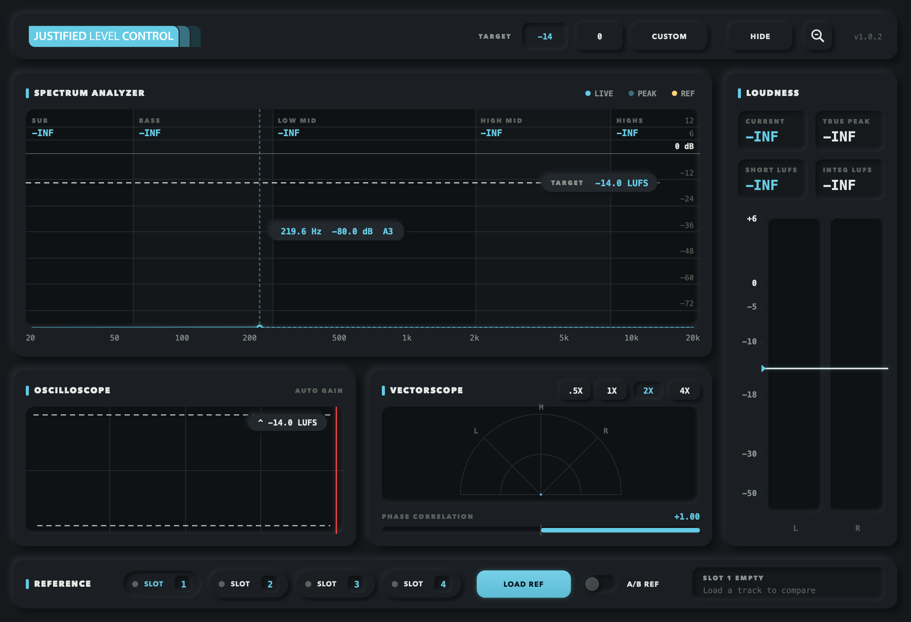

# Justified Level Control (JLC)

**A master-bus loudness and spectrum meter, as a VST3 / AU plugin.**

JLC puts everything you need to hit a loudness target on one screen: a live spectrum analyzer, true-peak and LUFS metering, an oscilloscope, a vectorscope, and A/B reference tracks. One draggable **target line** ties it together, so you can see at a glance when any part of the mix goes over.



## Features

- **Spectrum analyzer.** 2048-point FFT on a log 20 Hz – 20 kHz scale, with a 5-second peak-hold trace and an overlay of the reference track. Five frequency zones (Sub, Bass, Low Mid, High Mid, Highs) each show their peak, which turns red when it goes over target. Hover for a crosshair readout of frequency, level and musical note.
- **Loudness.** ITU-R BS.1770 short-term and integrated LUFS, current peak, and 4× oversampled true peak, plus stereo L/R meters on a non-linear scale. Click the readouts to reset the peak hold.
- **Target line.** Drag it on the spectrum or the meter, or use the **-14** / **0** / **Custom** presets. It shows on every view, turns red when you're over, and **Hide** turns it off.
- **Oscilloscope** with auto gain, and a **vectorscope** with .5× – 4× zoom and a phase-correlation bar.
- **Reference tracks.** Four slots (WAV, AIFF, MP3, FLAC). Each track is analysed in full, and **A/B Ref** swaps the readouts to the reference's numbers. Metering only: the audio is never changed.
- **Scalable UI.** The window resizes from 50% to 150% and keeps its proportions.

## Building

Requirements: CMake 3.22+, a C++17 compiler (Xcode / Command Line Tools on macOS, Visual Studio 2022 on Windows) and Git. JUCE 8.0.0 is downloaded automatically by CMake.

```bash
cmake -S . -B build -DCMAKE_BUILD_TYPE=Release
cmake --build build --config Release
```

On Windows, add `-G "Visual Studio 17 2022" -A x64` to the first command.

Outputs land in `build/JustifiedLevelControl_artefacts/Release/` (`VST3/`, `AU/` on macOS, and `Standalone/`). Copy the plugin into your system plugin folder:

| Format | Location |
|---|---|
| VST3 (Windows) | `C:\Program Files\Common Files\VST3\` |
| VST3 (macOS) | `/Library/Audio/Plug-Ins/VST3/` |
| AU (macOS) | `/Library/Audio/Plug-Ins/Components/` |

Then rescan plugins in your DAW and insert **Justified Level Control** on the master bus.

### macOS helpers

- `./run-standalone.sh` rebuilds the standalone app and launches it, for quick UI iteration without a DAW.
- `./build-installer.sh` builds the AU and VST3 and packages them into `build/JustifiedLevelControl.pkg` with [Packages](http://s.sudre.free.fr/Software/Packages/about.html).

## Notes

Built with [JUCE](https://juce.com) under its own license terms.

## License

Copyright © 2026 benjaminwellssss. All rights reserved. The source is published for viewing only; see [LICENSE](LICENSE).
